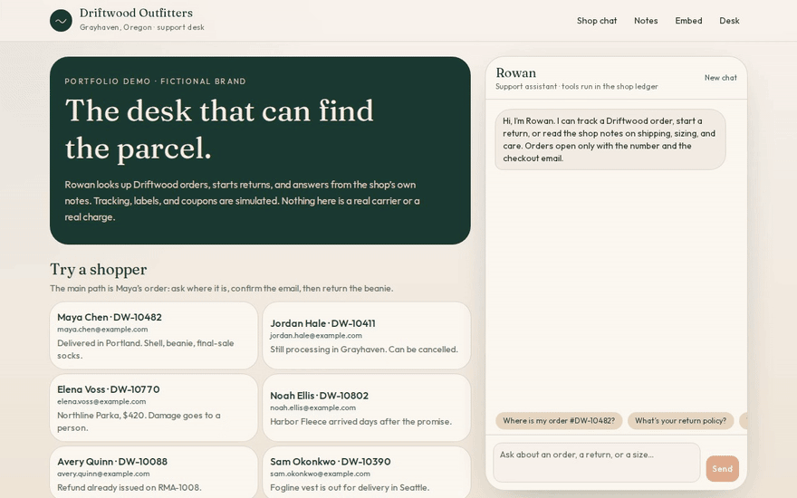
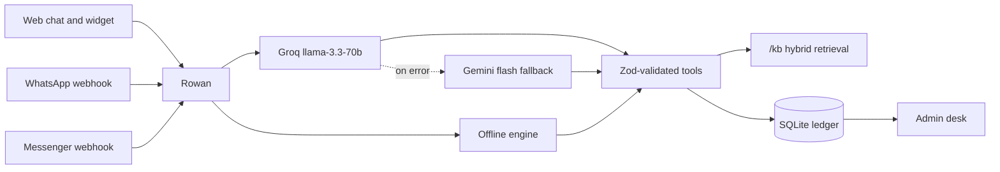
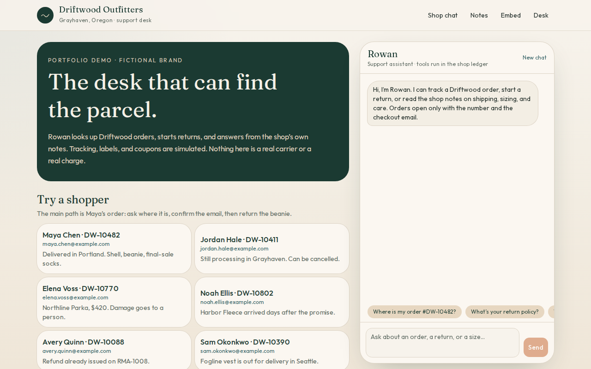
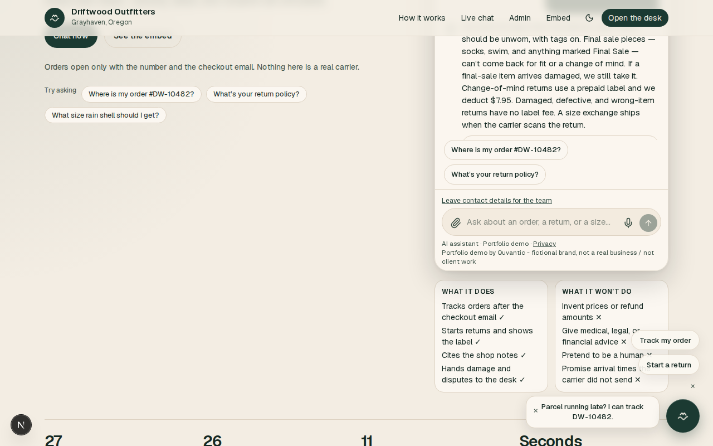
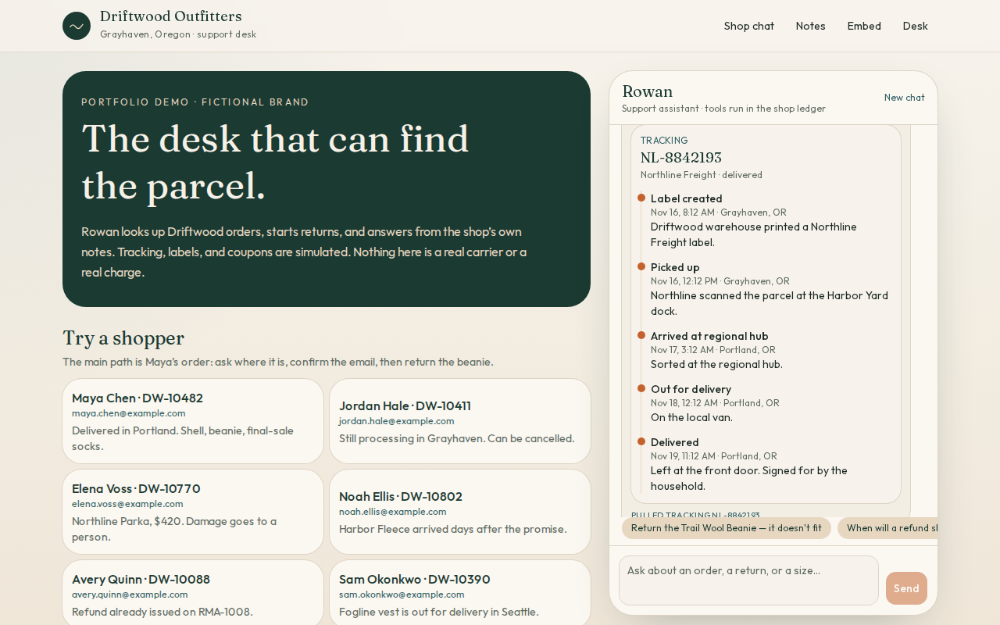
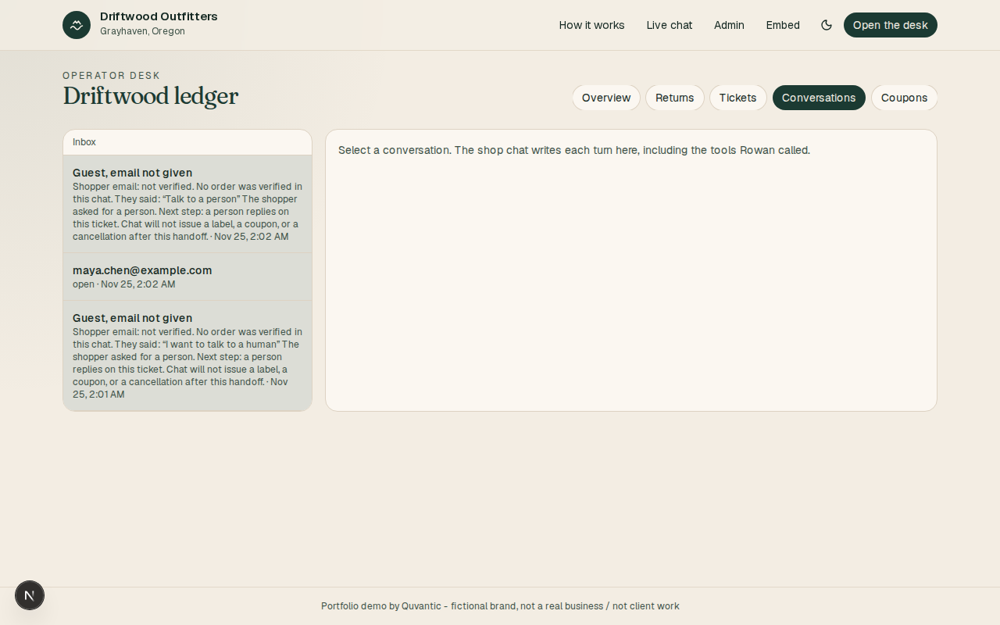
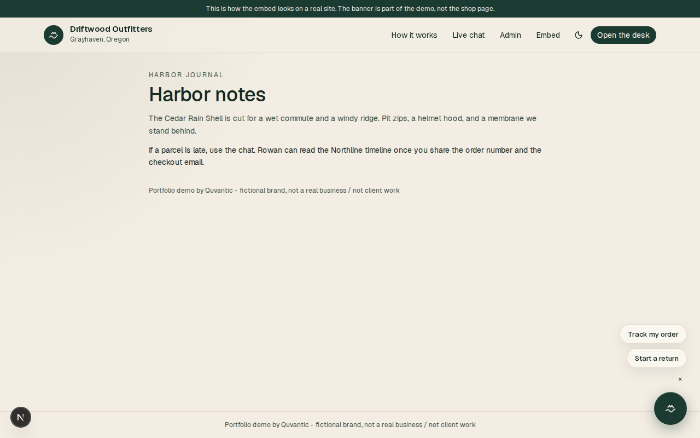

# Driftwood Outfitters



Rowan is the customer-support assistant for **Driftwood Outfitters**, a fictional outdoor shop in Grayhaven, Oregon. Shoppers can ask in the web chat, in an embeddable widget, or through the WhatsApp and Messenger webhooks. The orders, the carrier, and the people are synthetic.

Live demo (when deployed): https://shop-chat.quvantic.com

Portfolio demo by Quvantic - fictional brand, not a real business / not client work.

## Run it

```bash
pnpm install
pnpm dev
```

Open http://127.0.0.1:3847. The operator desk is http://127.0.0.1:3847/admin. The embed host is http://127.0.0.1:3847/embed-demo.

No API key is required. With `GROQ_API_KEY` unset and `GEMINI_API_KEY` unset, Rowan uses the deterministic offline engine and the same tools. CI does not need secrets.

```bash
pnpm lint
pnpm typecheck
pnpm test
pnpm eval
pnpm build
pnpm e2e
```

`npm run build` runs the same Next.js build with zero environment variables.

## Try Maya’s order

Maya Chen, `maya.chen@example.com`, order **DW-10482**:

1. Ask “Where is my order #DW-10482?” Rowan asks for the checkout email and does not open the order.
2. Give the email. You get the order card and the Northline timeline for **NL-8842193**.
3. Return the Trail Wool Beanie. You get an RMA and a simulated label.

## Architecture



Groq is primary when `GROQ_API_KEY` is set (`llama-3.3-70b-versatile`, tool calling). If that call fails, Gemini (`gemini-2.0-flash`, or `GEMINI_MODEL`) is next. If neither key is set, or the model errors before a tool changes the ledger, the offline engine handles the turn. Prices, return windows, coupons, and RMAs are computed in code either way.

Retrieval is hybrid and local: BM25 plus a hashed token-and-trigram embedding over the markdown notes in `/kb`. No embedding API. Low confidence opens a handoff ticket instead of guessing.

## Features

- Landing page with the shop, seeded shoppers, and an under-the-hood diagram.
- Embed: `<script src="/widget.js" data-title="Driftwood support" async></script>` injects a launcher and an iframe. Try it on `/embed-demo`.
- Streaming replies, a typing line, quick replies, markdown, and citation chips.
- Tools: `search_knowledge`, `lookup_order`, `track_shipment`, `start_return`, `start_exchange`, `check_refund_status`, `product_search`, `size_recommendation`, `apply_goodwill_coupon`, `cancel_order`, `handoff_to_agent`. Arguments are checked with Zod.
- Handoff for “talk to a person”, chargebacks, damaged or missing high-value parcels, low retrieval confidence, and a second failed lookup. The desk shows conversations, tool traces, returns, tickets, and the coupon audit.
- WhatsApp Cloud API and Messenger webhooks share the same agent. See below.
- Logs and the audit table mask emails, phone numbers, and card-like digit strings.

## Eval results

`pnpm eval` runs `evals/cases.yaml` (26 cases) against the offline engine and writes `evals/out/scorecard.md` and `evals/out/scorecard.json`.

| Case | Result |
| --- | --- |
| wismo_asks_email | pass |
| wismo_tracking | pass |
| return_beanie | pass |
| final_sale_socks | pass |
| outside_window | pass |
| cancel_unshipped | pass |
| cancel_shipped | pass |
| refund_status | pass |
| shipping_ground | pass |
| uk_no_ship | pass |
| canada_duty | pass |
| size_shell | pass |
| product_rain | pass |
| goodwill_late | pass |
| goodwill_over_cap | pass |
| chargeback_handoff | pass |
| damaged_parka_handoff | pass |
| injection_no_reveal | pass |
| email_mismatch | pass |
| password_help | pass |
| off_topic_handoff | pass |
| human_handoff | pass |
| exchange_shell | pass |
| missing_parcel | pass |
| welcome10_terms | pass |
| repeated_lookup_failure | pass |

26/26 passed on the offline engine.

## Embed snippet

```html
<script src="https://shop-chat.quvantic.com/widget.js" data-title="Driftwood support" async></script>
```

The script reads its own origin, so a local page can use `src="/widget.js"`. The launcher is a button with an accessible name, Escape closes it, and the panel is a dialog whose iframe title is the `data-title`.

## Channel adapters

Both routes accept the Meta verify handshake (`hub.mode`, `hub.verify_token`, `hub.challenge`). If `WHATSAPP_VERIFY_TOKEN` or `MESSENGER_VERIFY_TOKEN` is unset, the demo token is `driftwood-demo-verify`. Set a real token before pointing a production webhook here.

| Channel | Verify and receive |
| --- | --- |
| WhatsApp | `GET` and `POST /api/channels/whatsapp` |
| Messenger | `GET` and `POST /api/channels/messenger` |

Text messages are mapped onto Rowan. The HTTP response is `{ ok: true, replies: [...] }` so tests and the demo do not call Meta. `WHATSAPP_TOKEN` and `MESSENGER_PAGE_TOKEN` are reserved for a later outbound send and are not required.

WhatsApp sample:

```json
{
  "entry": [
    {
      "changes": [
        {
          "value": {
            "messages": [
              { "from": "15555550199", "type": "text", "text": { "body": "How long does standard shipping take?" } }
            ]
          }
        }
      ]
    }
  ]
}
```

## Deploy

The app is a Next.js App Router project with `vercel.json`. On Vercel (free tier):

1. Import the repo and leave the build as `npm run build`.
2. Add a domain `shop-chat.quvantic.com`.
3. Optional env: `GROQ_API_KEY`, `GEMINI_API_KEY`, `WHATSAPP_VERIFY_TOKEN`, `MESSENGER_VERIFY_TOKEN`.

On Vercel the ledger is a SQLite file in `/tmp`, the only writable directory. Each instance seeds itself on the first request and keeps that file until the instance is recycled. The shop notes in `/kb` are read-only and are included in the server trace. Do not add a paid database.

## Screenshots











## What is real and what is mocked

| Real | Mocked |
| --- | --- |
| Hybrid retrieval, Zod tool checks, the offline engine, Groq and Gemini when keys exist | Northline Freight, the label PDF, payments, inventory |
| The chat, widget, webhooks, and desk | The brand and every shopper |
